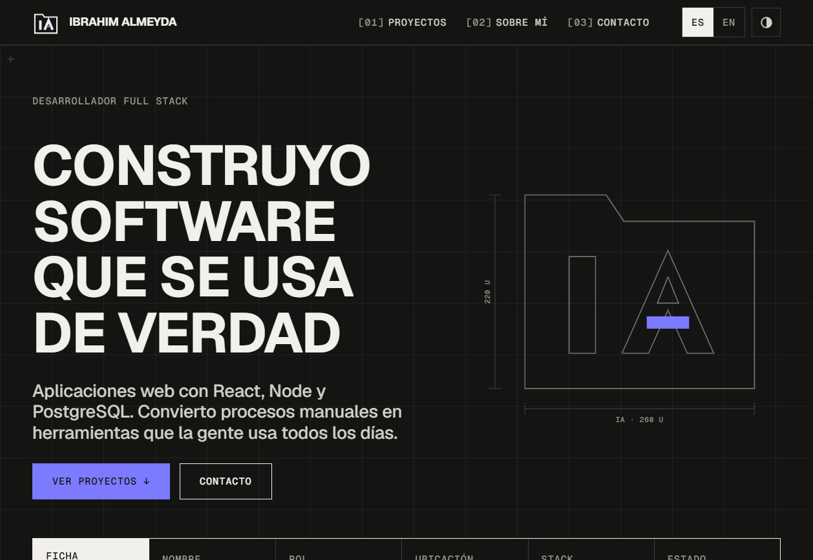

# Portafolio

Portafolio personal bilingüe (español / inglés) construido con [Astro](https://astro.build). Presenta quién soy, mis proyectos y cómo contactarme.

## Sitio

<!-- TODO: reemplazar con la URL del sitio desplegado -->
Ver sitio en vivo: [ibrahimalmeyda.dev](https://www.ibrahimalmeyda.dev/)
<!-- TODO: agregar la captura (por ejemplo public/screenshot.png) y ajustar la ruta -->


## Requisitos

- Node.js >= 22.22.0

## Uso

```bash
npm install
npm run dev      # servidor de desarrollo
npm run build    # build de producción en dist/
npm run preview  # previsualizar el build
```

## Estructura

- `src/components/`: secciones de la página (Hero, Sobre mí, Proyectos, Contacto).
- `src/content/projects.json`: datos de los proyectos, con un bloque `es` y otro `en` cada uno. El esquema se valida en `src/content.config.ts`.
- `public/`: recursos estáticos.

## Idiomas

El español es el idioma por defecto (`/`) y el inglés se sirve bajo `/en`.
